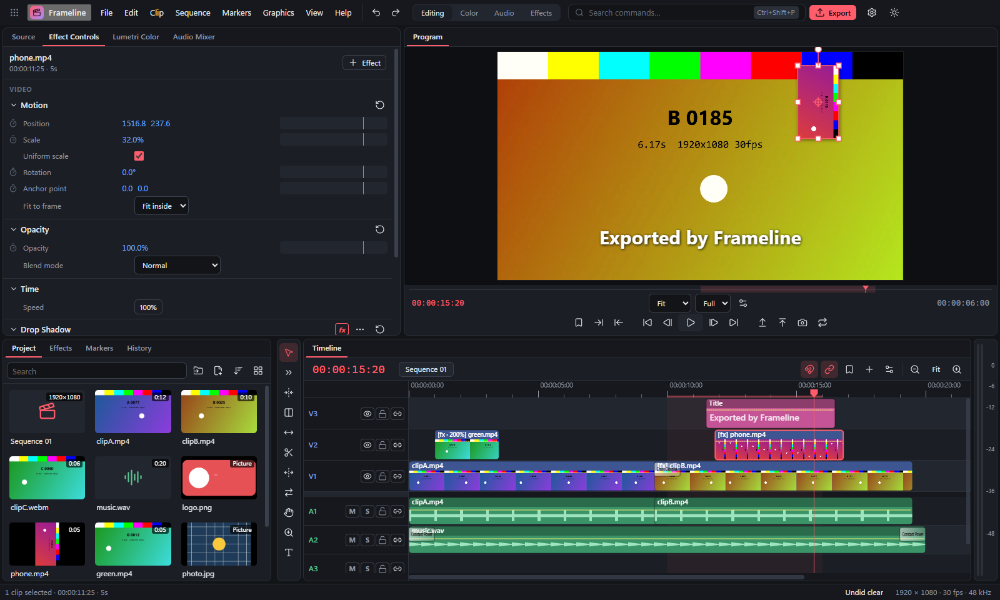

# Frameline

**A free video editor for Windows that works like Premiere Pro.** Cut a YouTube video, a short for your phone or a family film on a multi-track timeline, with titles, transitions, color correction, effects with keyframes and an audio mixer, then export an MP4 that plays everywhere.

Frameline is a sister app of [Gridline](https://github.com/LucasHeh47/gridline), [Pixelline](https://github.com/LucasHeh47/pixelline) and [Baseline](https://github.com/LucasHeh47/baseline), and shares their look.

## Download and install

1. Go to the **[releases](https://github.com/LucasHeh47/frameline/releases)**.
2. Under **Assets**, download one of these files:

   | File | What it is |
   | --- | --- |
   | **`Frameline-Setup-x.y.z.exe`** | **The installer (recommended).** It adds Frameline to the Start menu and the desktop, opens `.frameline` projects with a double-click, and updates itself. |
   | `Frameline-Portable-x.y.z.exe` | A single file you can run from anywhere without installing. It tells you when a new version is available. |

3. Run the file you downloaded. (If you use [Baseline](https://github.com/LucasHeh47/baseline), it can install Frameline for you.)

> **"Windows protected your PC"?** Frameline isn't signed with a paid code-signing certificate, so Windows SmartScreen may warn you the first time. Click **More info**, then **Run anyway**. Only download Frameline from this repository's Releases page.

**Requirements:** Windows 10 or 11 (64-bit) with a graphics card that supports WebGL 2 (any from the last ten years).

## What it does

**The editing you'd expect**

- **Import** video (MP4, MOV, WebM, MKV), sound (MP3, WAV, M4A, OGG, FLAC) and pictures, or drag them onto the window. Phone videos come in upright.
- **A Premiere-style workspace**: Source and Program monitors, the Project panel (with bins and thumbnails you can scrub by moving the mouse), Effect Controls, Lumetri Color, the Audio Mixer, Effects, Markers and History. Switch between the **Editing, Color, Audio and Effects** workspaces at the top.
- **A multi-track timeline** with filmstrip thumbnails and waveforms, snapping, markers, in and out points, and track lock, hide, mute, solo and sync lock. A clip and its sound stay linked.
- **The editing tools and keys you know**: Selection (V), Track Select (A), Ripple (B), Rolling (N), Rate Stretch (R), Razor (C), Slip (Y), Slide (U), Hand (H), Zoom (Z) and Type (T). Insert and overwrite (, and .), Ctrl+K to cut at the playhead, Q and W to trim to it, lift and extract, ripple delete, J/K/L shuttle, and paste attributes.
- **Mark the part you want** in the Source monitor and drop it in — or drag only its picture or only its sound.
- **Move, scale and rotate clips right in the Program monitor**, and edit titles by double-clicking them.

**Making it look good**

- **Effect Controls with keyframes** for everything that has a number: Motion, Opacity with 12 blend modes, every effect setting, volume and balance. Ease in and out, or hold.
- **Lumetri Color**: white balance, exposure, contrast, highlights and shadows, whites and blacks, saturation and vibrance, faded film, a vignette, and **.cube LUT looks**. **Auto** corrects from the frame at the playhead. **Scopes** (waveform, RGB parade and vectorscope) show what the picture really looks like while you grade.
- **Effects**: Gaussian Blur, Sharpen, Glow, **Ultra Key** (green screen), Luma Key, Crop, Flip, **Mask** (to blur a face or spotlight something), Drop Shadow, Mosaic, Film Grain, Brightness & Contrast, Hue / Saturation, Black & White, Sepia, Tint, Invert and Posterize. **Adjustment layers** apply effects to everything below them.
- **Transitions**: Cross Dissolve, Dip to Black, Dip to White, Blur Dissolve, Wipe, Iris, Slide, Push and Cross Zoom. Ctrl+D adds one at the playhead; drag its edges to change its length.
- **Titles** in styles like a lower third, a subtitle or a big statement, with outlines, shadows and background boxes. **Captions** import from `.srt` / `.vtt` files and export back.
- **Presets**: fade in and out, a slow Ken Burns zoom, picture-in-picture, warm, cool, cinematic, vintage and black-and-white looks, and green screen in one click.

**Sound**

- **Audio Track Mixer** with faders, balance, mute, solo and meters, plus master meters beside the timeline.
- **Audio effects**: Amplify, Simple EQ, Highpass, Lowpass, Dynamics (compressor), Studio Reverb, Delay, and Channels (fixes sound that's only on one side). **Normalize** sets the loudest moment to a level.
- **Crossfades** (constant power, constant gain, exponential) and volume lines you can drag on the timeline.
- **Record a voice-over** straight onto an audio track: press the microphone on the track, talk while the video plays, and press Space to stop. Recordings are saved in your Videos folder under *Frameline voice-overs*.
- **Auto-duck** lowers the music wherever someone speaks, with keyframes you can adjust afterwards (right-click the music, or Clip > Auto-duck music).

**Clever helpers**

- **Scene edit detection** cuts a long video wherever the camera cut.
- **Speed / Duration** (slow motion, fast motion, reverse) and **frame holds**.
- The first video you add can set the sequence's size and frame rate.
- **Automatic saving and recovery** after a crash, and a start page with presets for HD, 4K, vertical (Shorts, Reels, TikTok) and square videos.

**Export**

- **MP4 (H.264)**, **WebM (VP9)** or **MOV**, or just the sound as **M4A** or **WAV**, at the sequence's size or smaller, with a quality choice that picks a sensible bitrate and shows the file size first. The whole sequence or just in to out.
- Exports use your graphics card's video encoder, so they're fast, and they match the preview frame for frame.
- **Export Frame** (Ctrl+Shift+E) saves a still as PNG or JPEG.

## Keyboard shortcuts

Every command is searchable with **Ctrl+Shift+P**, and **Help → Keyboard shortcuts** lists them all. The most useful:

| Keys | What they do |
| --- | --- |
| Space | Play / stop |
| J / K / L | Play backwards / stop / play forwards (press again to go faster) |
| ← / → | One frame back / forward |
| ↑ / ↓ | Previous / next cut |
| I / O | Mark in / out |
| Ctrl+K | Cut the clips under the playhead |
| Q / W | Trim the clip's start / end to the playhead and close the gap |
| Shift+Delete | Ripple delete |
| Ctrl+D | Add a cross dissolve at the playhead |
| Ctrl+R | Speed / Duration |
| Ctrl+T | New title |
| M | Add a marker |
| Ctrl+M | Export |

## Building it yourself

See **[docs/development.md](docs/development.md)**.

## License

[MIT](LICENSE)
